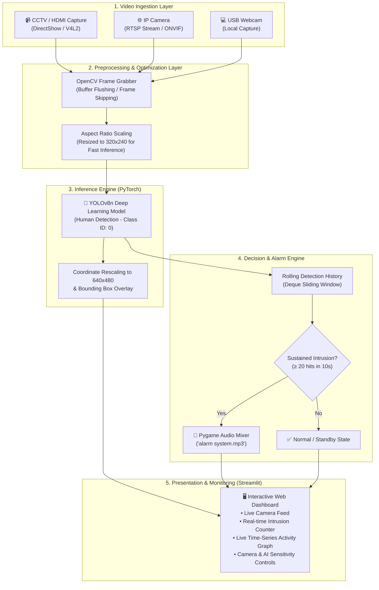
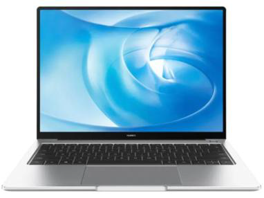
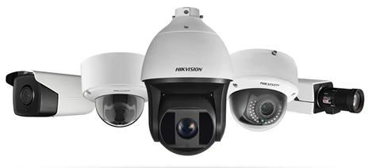
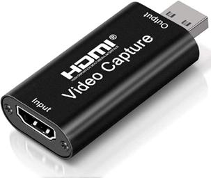
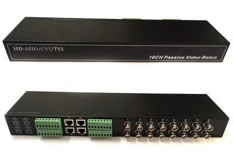

<div align="center">

# 🛡️ AI-Powered Smart Home Security System
### Real-Time Human Detection & Automated Threat Monitoring System

[](https://www.python.org/)
[](https://streamlit.io/)
[](https://github.com/ultralytics/ultralytics)
[](https://opencv.org/)
[](https://pytorch.org/)
[](LICENSE)

<p align="center">
  <b>An end-to-end intelligent home security solution integrating cutting-edge YOLOv8 deep learning, multi-source hardware ingestion (HDMI Capture Card & RTSP IP Camera), automated audio alarms, and an interactive real-time Streamlit monitoring dashboard.</b>
</p>

<p align="center">
  
</p>

[Project Overview](#-project-overview) •
[System Architecture](#-system-architecture) •
[Core Technologies](#-core-technologies) •
[Hardware Integration](#-hardware-integration--schematics) •
[Equipment List](#-hardware-components--equipment) •
[Installation & Usage](#-installation--quick-start) •
[Remote Deployment](#-remote-deployment-via-ngrok) •
[Project Team](#-project-team--acknowledgments)

---

</div>

## 📌 Project Overview

Conventional home security systems (traditional CCTV) rely heavily on passive recording and manual human surveillance, making proactive intrusion prevention ineffective and prone to human error.

**Smart Home Security System** solves this issue by infusing real-time **Computer Vision** and **Deep Learning** into surveillance workflows:
- **Instantaneous Threat Detection**: Uses **YOLOv8 Nano (`yolov8n.pt`)** to detect human presence (*class 0: person*) in real-time.
- **Automated Alarm Siren**: Integrates an autonomous audio alert mechanism (`alarm system.mp3`) triggered when suspicious movement or high-frequency human detection occurs within a configurable time window.
- **Dual Hardware Pipeline**: Ingests both **Analog/HD CCTV cameras** (via USB 3.0 HDMI Video Capture Card) and wireless **IP Cameras** (via RTSP network streams).
- **Intuitive Web Dashboard**: Built with a reactive **Streamlit** user interface offering live visual feeds, dynamic time-series activity charts, system status metrics, and AI parameter controls.

---

## 🏗️ System Architecture

The pipeline processes live video feeds with minimal latency through a highly optimized multi-stage processing flow:



---

## 🧠 Core Technologies & Theory

### 1. YOLOv8 Deep Learning Algorithm
The system utilizes **YOLOv8 (You Only Look Once - Version 8)** developed by Ultralytics. YOLOv8 is a state-of-the-art, single-stage object detector designed for high precision and ultra-fast inference speed.

<p align="center">
  
</p>

* **Anchor-Free Detection**: Eliminates predefined anchor boxes, directly predicting the center coordinates and dimensions of bounding boxes.
* **Decoupled Head**: Separates classification and bounding-box regression tasks to improve training convergence and precision.
* **Lightweight Nano Model (`yolov8n.pt`)**: Optimized with just ~3.2M parameters, allowing responsive real-time inference on standard CPU environments without dedicated GPUs.
* **Target Filtering**: Specifically filters for `class 0` (`person`), eliminating false alerts from non-threatening moving entities.

---

### 2. Streamlit Web Application Framework
The user interface is powered by **Streamlit**, configured with custom CSS styles following an executive color palette (*Navy Blue `#27548A`*, *Gold `#DDA853`*, and *Dark Teal `#183B4E`*).

<p align="center">
  
</p>

* **Reactive State Management**: Uses `st.session_state` to synchronize streaming state, camera capture handlers, detection buffers, and alarm triggers.
* **Resource Caching (`@st.cache_resource`)**: Keeps the YOLO model loaded in memory, eliminating redundant initialization overhead.
* **Live Analytics**: Visualizes detection frequency using continuous time-series charts generated via **Pandas** and native Streamlit graphing tools.

---

## 🔌 Hardware Integration & Schematics

The project supports two distinct hardware architectures depending on the user's infrastructure:

### Architecture A: Analog / HD CCTV via HDMI Capture Card
Used for traditional CCTV installations (BNC coaxial output) connected to a central monitoring PC.

<p align="center">
  
</p>

1. **Video Signal Path**: CCTV Camera ➡️ Coaxial Cable / Video Balun Transceiver ➡️ Video Converter ➡️ HDMI Cable ➡️ USB 3.0 HDMI Video Capture Card.
2. **PC Ingestion**: The capture card acts as a standardized DirectShow video device (`cv2.CAP_DSHOW` on Windows), enabling fast, low-overhead frame grabbing.
3. **Camera Auto-Detection**: The system automatically scans device indices `0` through `4` to auto-connect to the active video card.

---

### Architecture B: Smart IP Camera via RTSP Network Streaming
Used for modern Wi-Fi or Ethernet-based IP Cameras supporting ONVIF or RTSP (e.g., V380, Hikvision, Dahua).

<p align="center">
  
</p>

1. **Network Topology**: The IP Camera connects wirelessly or via RJ45 LAN Cable to a local TP-Link Router / Access Point.
2. **RTSP Transmission**: Video frames are streamed via Real-Time Streaming Protocol over port `554`.
3. **Protocol Formats Supported**:
   - Generic IP Camera: `rtsp://<IP_ADDRESS>:554/stream`
   - Authenticated Stream: `rtsp://<USERNAME>:<PASSWORD>@<IP_ADDRESS>:554/stream`
   - Hikvision / Dahua Channel: `rtsp://<USERNAME>:<PASSWORD>@<IP_ADDRESS>:554/Streaming/Channels/101`

---

## 🧰 Hardware Components & Equipment

The physical testbed and prototyping setup was implemented using the following hardware components:

| Hardware Component | Illustration | Function & Specification |
| :--- | :---: | :--- |
| **Host Processing Laptop** |  | Central computation unit executing YOLOv8 model inference and hosting the Streamlit web dashboard. |
| **HD CCTV Camera** |  | Fixed security surveillance camera providing analog/HD composite video output. |
| **Wireless IP Camera** |  | Smart camera supporting Wi-Fi connectivity and RTSP/ONVIF video streaming protocol. |
| **HDMI Video Capture Card / Converter** |  | Converts HDMI video signals into USB video stream recognizable by OpenCV. |
| **TP-Link Wi-Fi Router / Modem** |  | Provides Local Area Network (LAN) routing and DHCP addressing for IP Cameras. |
| **Video Balun Transceiver** |  | Converts BNC coaxial video transmission to twisted-pair cabling with impedance matching. |
| **Coaxial Video Cable** |  | High-shielding cable transmitting high-frequency analog signals from CCTV. |
| **High-Speed HDMI Cable** |  | Carries uncompressed digital video output from the converter into the capture card. |
| **UTP / LAN RJ-45 Cable** |  | High-stability wired Ethernet connection between router and local network nodes. |
| **USB to Micro-USB Cable** |  | 5V DC power supply line powering the camera and peripheral converter units. |

---

## 🚀 Installation & Quick Start

### 1. Prerequisites
- **Operating System**: Windows 10/11, Ubuntu 20.04+, or macOS
- **Python**: Version `3.9`, `3.10`, or `3.11`
- **Camera Source**: USB Webcam, HDMI Video Capture Card, or RTSP IP Camera

### 2. Clone the Repository
```bash
git clone https://github.com/billiampalad/sistem_keamanan_rumah.git
cd sistem_keamanan_rumah
```

### 3. Create a Virtual Environment (Recommended)
```bash
# Windows
python -m venv venv
venv\Scripts\activate

# Linux / macOS
python3 -m venv venv
source venv/bin/activate
```

### 4. Install Dependencies
```bash
pip install -r requirements.txt
```
*Alternatively, install core packages manually:*
```bash
pip install streamlit opencv-python ultralytics numpy pandas pygame torch torchvision
```

### 5. Validate Camera Connection (`test_camera.py`)
Run the built-in diagnostic utility to scan connected video capture devices, measure resolution, and benchmark FPS:
```bash
python test_camera.py
```

### 6. Launch the Smart Security Dashboard
```bash
streamlit run index.py
```
Open your web browser and navigate to: **`http://localhost:8501`**

---

## 🌐 Remote Deployment via Ngrok

To monitor your security system remotely from any smartphone, laptop, or external network outside your home Wi-Fi:

1. Download and authenticate [Ngrok](https://ngrok.com/).
2. Open **Terminal 1** and start the Streamlit application:
   ```bash
   streamlit run index.py --server.port 8501
   ```
3. Open **Terminal 2** and start the public Ngrok tunnel:
   ```bash
   ngrok http 8501
   ```
4. Copy the public URL from the `Forwarding` line (e.g., `https://xxxx-xx-xx.ngrok-free.app`) to access the live dashboard securely from anywhere in the world.

---

## 📁 Repository Structure

```text
sistem_keamanan_rumah/
│
├── index.py                    # Main Streamlit web application & AI detection logic
├── test_camera.py              # Camera indexing and FPS benchmarking utility
├── requirements.txt            # Python environment dependencies
├── yolov8n.pt                  # Pre-trained YOLOv8 Nano PyTorch weights
├── alarm system.mp3            # Audio alert siren asset
├── README.md                   # Comprehensive project documentation
├── laporan.md                  # Academic report & hardware specifications
│
└── images/                     # Architectural diagrams & hardware schematics
    ├── Algoritma YOLO.png
    ├── Arsitektur Web Application.png
    ├── CCTV (HDMI CARD).png
    ├── Framework Streamlit.png
    ├── IP Camera RTSP.png
    └── alat/                   # Hardware component catalog
        ├── CCTV.png
        ├── Cable Coaxial.png
        ├── Converter.png
        ├── IP Camera RTSP.png
        ├── Kabel LAN.png
        ├── Kabel USB to MICRO.png
        ├── Modem TP-Link.png
        ├── Transceiver.png
        ├── kabel hdmi.png
        └── laptop.png
```

---

## 👥 Project & Acknowledgments

This project was conceived and developed as the Final Project for the **Machine Learning Workshop** course at **Politeknik Negeri Manado** (2025).

* **Institution:** D4 Informatics Engineering, Department of Electrical Engineering, Politeknik Negeri Manado

---

## 📄 License

This project is licensed under the [MIT License](LICENSE) — feel free to modify, distribute, and integrate it into your own research and applications.

<div align="center">
  <b>Built with ❤️ by Group 1 • Politeknik Negeri Manado</b>
</div>
